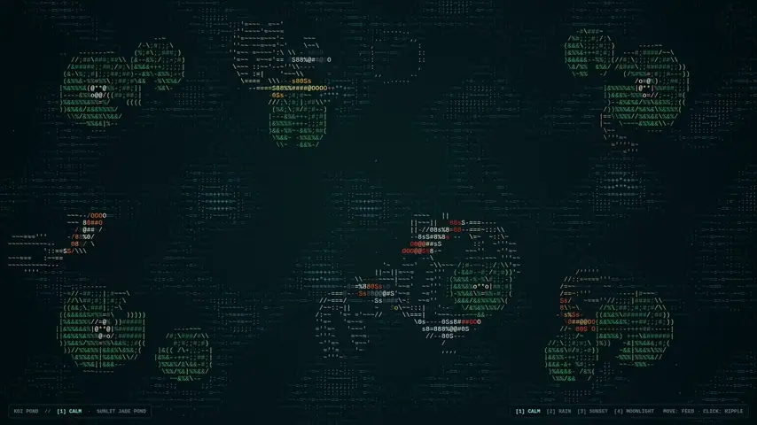

# ASCII Koi Pond

An original interactive, full-viewport ASCII / text-mode koi pond rendered on a 2D HTML Canvas (`192 × 60` monospace grid at 1920×1080, 60 fps), with zero external dependencies or asset files.

**Live demo:** https://artem-kaseka.github.io/ascii-koi-pond/  
**Full 1080p60 MP4 (with synthesized stereo ambience):** [ascii-koi-pond-1080p60.mp4](https://github.com/artem-kaseka/ascii-koi-pond/releases/download/v1.0.0/ascii-koi-pond-1080p60.mp4)



## Highlights

- **Shader-like cell compositor**: `main(x, y, t, pointer) -> { glyph, color }` composites multi-octave water caustics, ripple refraction, submerged koi shadows, 8 articulated Nishikigoi varieties (Kohaku, Showa, Yamabuki Ogon, Tancho, Sanke, Asagi, Benigoi, Shiro Utsuri) with flowing pectoral, pelvic, and forked veiltail fins, floating V-notched lily pads with lotus blossoms that occlude fish swimming underneath, floating food crumbs, and falling rain streaks.
- **Interactive Pond**:
  - **Move pointer**: trails floating food crumbs (`@`, `*`, `o`) that nearby koi actively swarm toward and nibble away.
  - **Click**: emits expanding concentric ripple rings that refract underlying glyphs and startle nearby koi into a rapid dart-away burst with bubble wakes.
  - **Keys `1`–`4`**: switch between 4 distinct presets with smooth transitions:
    1. **Calm** — sunlit deep-jade pond, warm daylight koi colors, gentle laps
    2. **Rain** — cool slate water, diagonal rain streaks, splashes, dense raindrop rings, brisker swim
    3. **Sunset** — twilight-plum water with warm gold/amber horizontal reflections, richer koi tones, dreamy swim
    4. **Moonlight** — deep midnight indigo, silver starlight sparkles, high-contrast dorsal highlights, slow hypnotic glide
  - **`Space`**: pause / resume
  - **`F`**: scatter a food cluster at the pointer
  - **`R`**: reset pond

## Running Live

Open [`index.html`](./index.html) directly in any modern browser, or serve this folder locally:

```bash
python3 -m http.server 8080
```

## Deterministic 1080p60 Capture

```bash
node capture.mjs
```

Drives `index.html?capture=1` frame-by-frame (`frameIndex / 60`) in headless Chrome via CDP, verifies determinism, synthesizes subtle original 48 kHz stereo water/rain/night ambience, pipes PNG frames directly into `ffmpeg` (`libx264` High, `yuv420p`, `+faststart`), verifies via `ffprobe`, and extracts QA stills into `stills/`.
